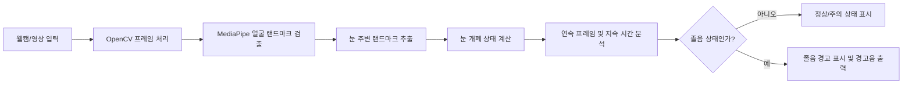
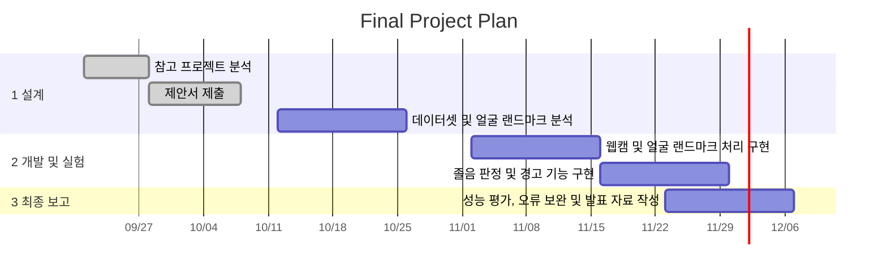

# 1. 프로젝트 개요

## 1.1. 기본 정보
- 프로젝트 제목 : **얼굴 랜드마크 기반 실시간 운전자 졸음 감지 및 경고 시스템**
- 작성일자 : 2026-10-06
- 학번 / 이름 : **[20242405 / 이 인]**

# 2. 서론 및 배경

## 2.1. 배경
- 문제 정의 : 운전 중 졸음은 운전자의 눈 감김, 느린 눈 깜빡임, 하품, 고개 움직임 등의 시각적 변화로 나타날 수 있다. 이러한 상태를 카메라 영상에서 실시간으로 감지하여 운전자에게 경고할 수 있다면 졸음 상태를 빠르게 인지하는 데 도움을 줄 수 있다.
- 제안 배경 : 교수님께서 제공한 「Top 100 Computer Vision Projects」 목록의 **68번 Drowsiness Detection**을 기반으로 프로젝트를 선정하였다. 웹캠에서 입력되는 운전자의 얼굴 영상을 컴퓨터 비전으로 분석하고, 얼굴 랜드마크를 이용하여 눈의 상태를 지속적으로 추적한다. 일정 시간 이상 눈이 감긴 상태가 지속되는 경우 졸음 상태로 판단하고 화면과 경고음을 통해 알리는 실시간 시스템을 구현하고자 한다.

## 2.2. 기여점
- 참고 프로젝트 주제 : **Top 100 Computer Vision Projects - 68. Drowsiness Detection**
- 기존 프로젝트와의 차별성 : 단일 이미지에서 졸음 여부만 분류하는 것이 아니라 웹캠 영상을 연속적으로 처리하여 운전자의 상태를 실시간으로 분석한다. 얼굴 랜드마크를 이용하여 눈 주변의 위치 정보를 추출하고, 눈의 개폐 상태와 지속 시간을 함께 고려하여 일시적인 눈 깜빡임과 장시간 눈 감김을 구분한다. 최종적으로 정상/주의/졸음 상태를 화면에 표시하고 졸음 상태가 일정 시간 지속되면 경고음을 출력하는 응용 시스템으로 구현한다.

# 3. 상세 내용

## 3.1. 개발 목표 및 접근법
- 정량적/정성적 달성 목표 :
  - 웹캠 영상에서 얼굴과 눈 주변 랜드마크를 실시간으로 검출
  - 눈의 개폐 상태를 프레임 단위로 계산하여 정상적인 눈 깜빡임과 지속적인 눈 감김을 구분
  - 일정 시간 이상 눈 감김이 지속될 경우 졸음 상태로 판정하고 경고 메시지 및 경고음 출력
  - 정상, 눈 깜빡임, 장시간 눈 감김 등의 테스트 상황을 직접 구성하여 검출 결과 기록
  - 공개 졸음 운전 영상 데이터 일부를 이용하여 다양한 사람과 환경에서 동작 여부 확인
  - 실행 화면에서 얼굴 랜드마크, 현재 상태, 측정값을 시각적으로 확인할 수 있도록 구현
- 핵심 알고리즘 및 접근법 :
  1. OpenCV의 VideoCapture를 이용하여 웹캠 영상을 프레임 단위로 입력
  2. MediaPipe Face Landmarker를 이용하여 얼굴의 주요 랜드마크 좌표 검출
  3. 양쪽 눈 주변의 랜드마크 좌표를 추출하여 눈의 열림/감김 정도 계산
  4. 눈이 감긴 것으로 판단되는 프레임의 연속 시간을 누적
  5. 짧은 눈 감김은 일반적인 눈 깜빡임으로 처리하고, 설정된 시간 이상 지속되는 경우 졸음 상태로 판정
  6. 현재 상태를 정상(NORMAL), 주의(WARNING), 졸음(DROWSINESS)으로 구분하여 화면에 표시
  7. 졸음 상태가 검출되면 화면 경고와 함께 경고음을 출력
  8. 공개 데이터 및 직접 촬영한 테스트 영상을 이용하여 오검출 및 미검출 사례 분석

## 3.2. 시스템 아키텍처
- 파이프라인 : **웹캠/영상 입력 -> 얼굴 랜드마크 검출 -> 눈 영역 랜드마크 추출 -> 눈 개폐 상태 계산 -> 연속 프레임/시간 분석 -> 졸음 여부 판정 -> 화면 및 경고음 출력**

학습 데이터셋 받기, 데이터셋 분석 << 랜드마크 추출한 예시 1개라도 보여주기 + 그 모든 내용을 중간 보고서에 담기

## 3.3. 입출력 인터페이스
- 입력 데이터 형태 : 웹캠을 통해 입력되는 RGB 실시간 영상 또는 졸음 운전 데이터셋의 동영상 파일
- 최종 출력 형태 :
  - 실시간 웹캠 영상
  - 얼굴 및 눈 주변 랜드마크 시각화
  - 눈 개폐 상태를 판단하기 위한 측정값
  - 현재 운전자 상태(NORMAL / WARNING / DROWSINESS)
  - 졸음 감지 시 화면 경고 메시지 및 경고음
  - 테스트 결과 분석을 위한 정상 검출, 오검출, 미검출 사례

# 4. 개발 환경

## 4.1. 데이터셋
- 데이터셋 이름 : **NTHU Driver Drowsiness Detection Dataset (NTHU-DDD)**
- 데이터셋 출처 : National Tsing Hua University Computer Vision Laboratory의 Driver Drowsiness Detection Dataset
- 데이터 규모 : 여러 피실험자의 운전자 영상을 포함하며 정상 운전, 하품, 느린 눈 깜빡임, 졸음 등의 다양한 상태와 주간/야간 및 안경 착용 등의 조건을 포함한다. 프로젝트에서는 전체 데이터를 새로 학습하기보다 일부 영상 및 프레임을 시스템 테스트와 결과 분석에 활용한다.
- 데이터 특징 : 운전자의 얼굴을 중심으로 촬영된 영상 데이터이며 정상 상태와 졸음과 관련된 행동이 포함되어 있다. 눈 상태, 입 상태, 머리 움직임 등 졸음 판단에 활용할 수 있는 시각적 특징을 포함한다. 추가로 웹캠을 이용한 직접 테스트 영상을 사용하여 실시간 동작을 확인한다.

## 4.2. 실행 환경
- 개발 언어 및 프레임워크 : Python 3.x
- 라이브러리 : OpenCV, MediaPipe, NumPy, 경고음 출력을 위한 Python 라이브러리
- 연산 환경 : Windows 11, VS Code, Conda 가상환경, 노트북 웹캠, CPU 기반 실시간 실행

# 5. 수행 계획

## 5.1. 개발 일정
- 6~7주차 : 참고 프로젝트 및 졸음 감지 방법 조사, MediaPipe 얼굴 랜드마크 검출 실습, NTHU-DDD 데이터 확인
- 9~12주차 : 웹캠 입력 구현, 눈 주변 랜드마크 추출, 눈 개폐 상태 계산 및 졸음 판정 기준 구현, 화면 경고 및 경고음 기능 연결
- 12~14주차 : 다양한 사용자와 조명 조건에서 실험, 공개 데이터 영상 테스트, 임계값 조정, 오검출/미검출 사례 분석 및 기말 발표 자료 작성

# 6. 참고 문헌
- 참고 프로젝트 : **Top 100 Computer Vision Projects Idea for 2024 - 68. Drowsiness Detection**
  - https://github.com/farukalamai/top-100-computer-vision-projects-idea-for-2024
- 논문 : Weng, C.-H. et al., **Driver Drowsiness Detection via a Hierarchical Temporal Deep Belief Network**, Asian Conference on Computer Vision Workshops (ACCVW), 2016.
- 기술 문서 : **MediaPipe Face Landmarker - Google AI Edge**
  - https://developers.google.com/edge/mediapipe/solutions/vision/face_landmarker/python
- 데이터셋 : **NTHU Driver Drowsiness Detection Dataset (NTHU-DDD)**, National Tsing Hua University Computer Vision Laboratory
